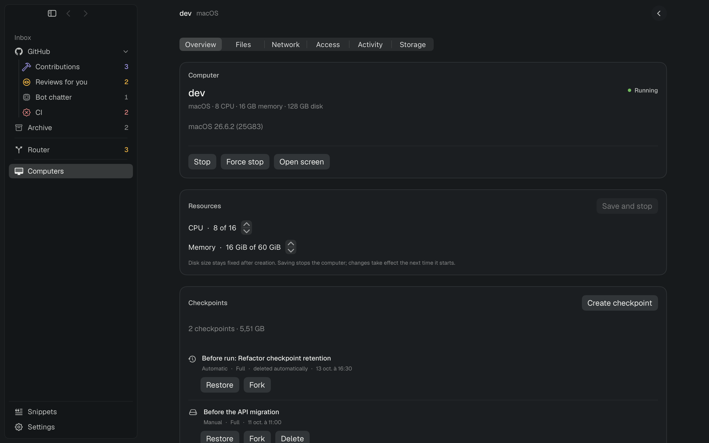
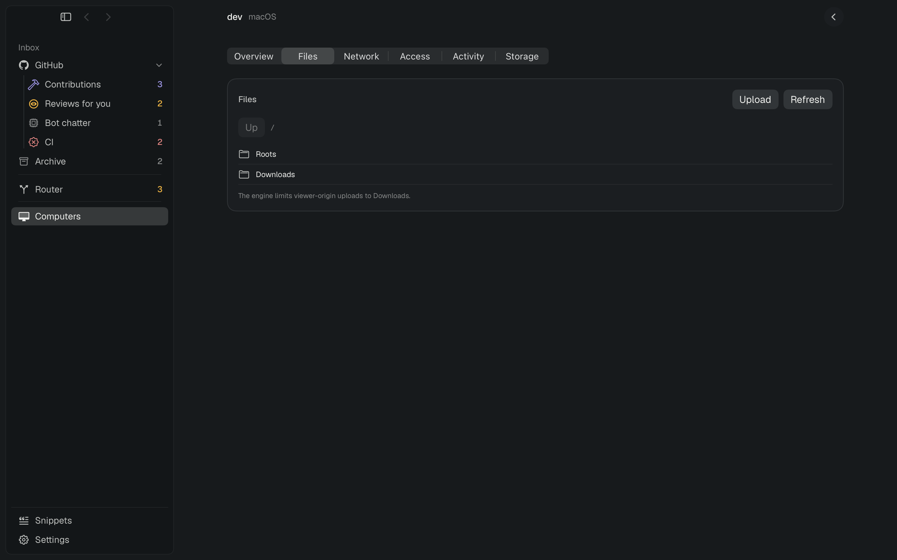
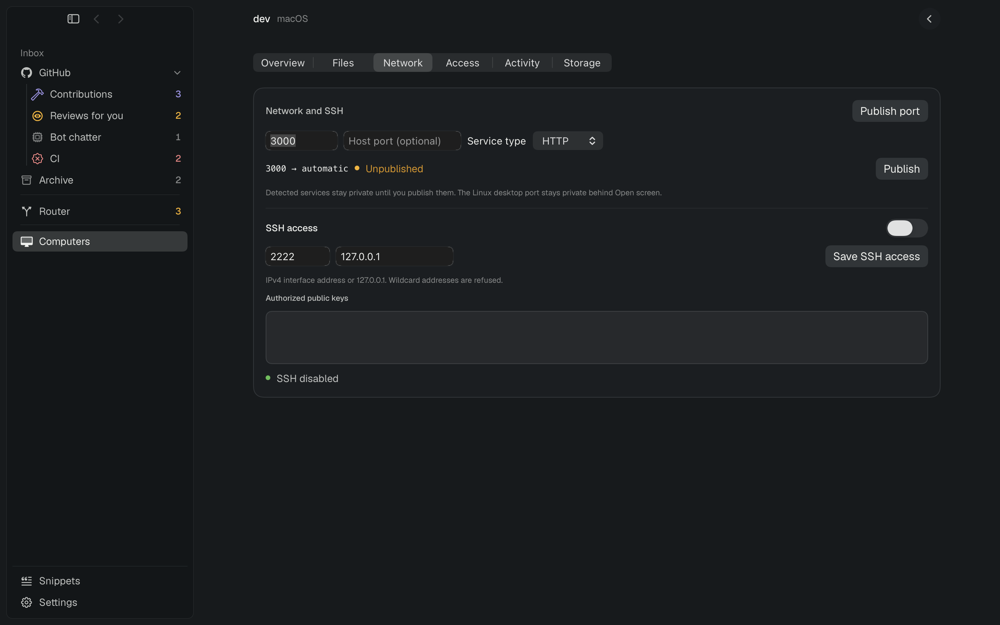
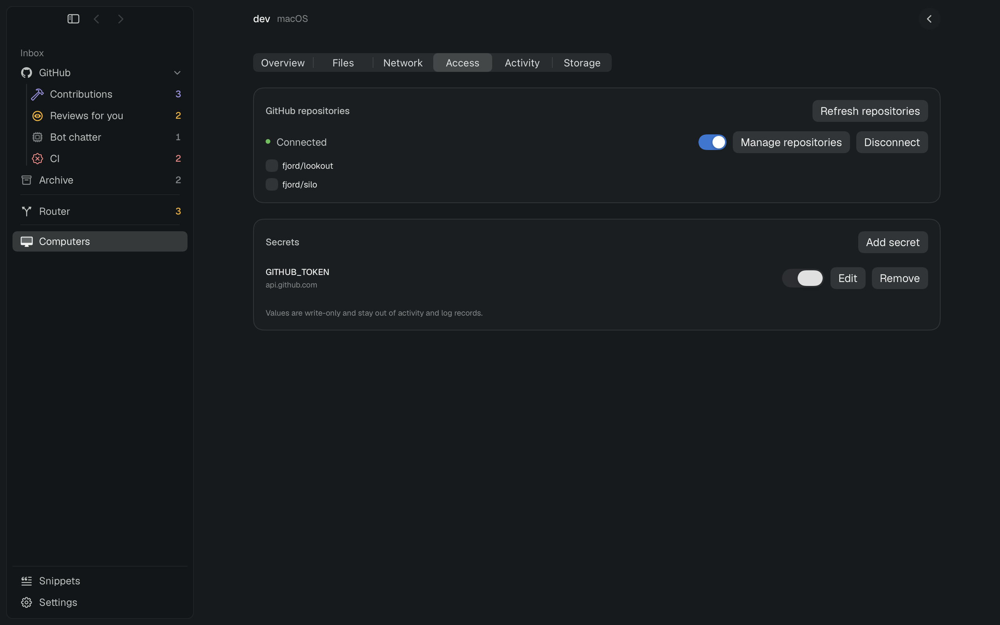
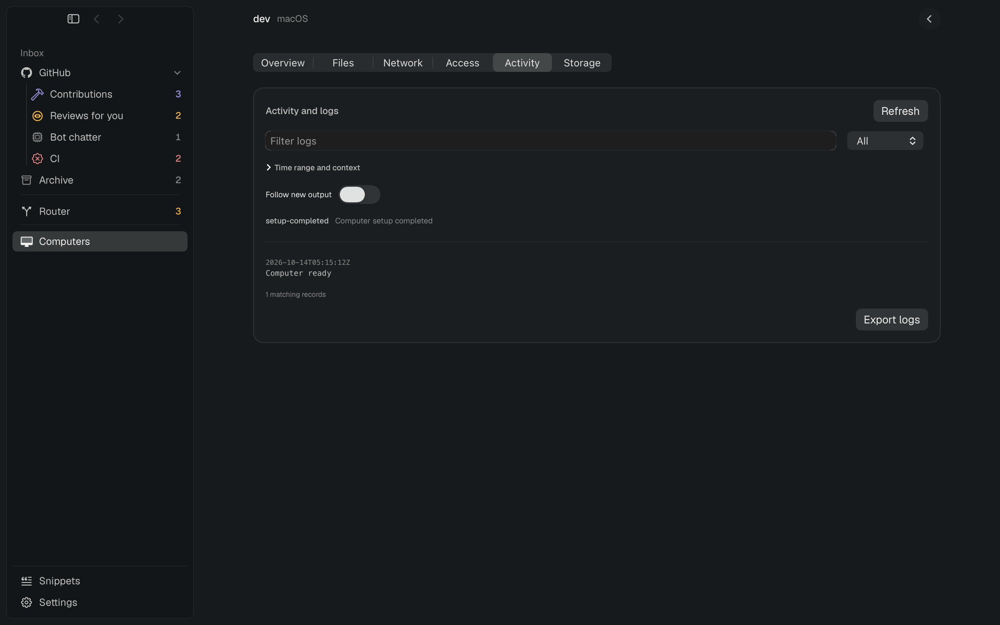
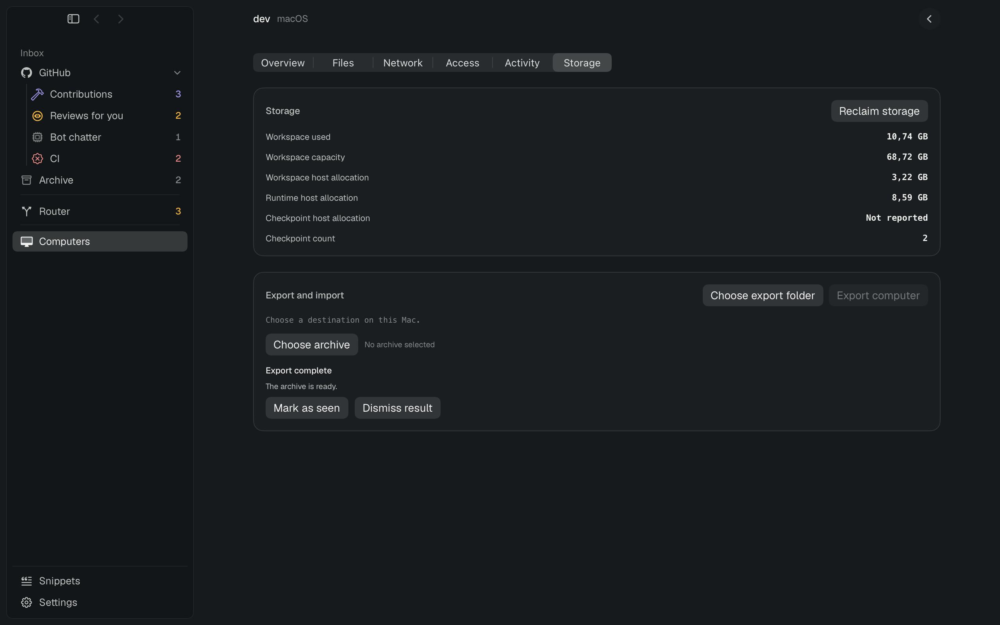
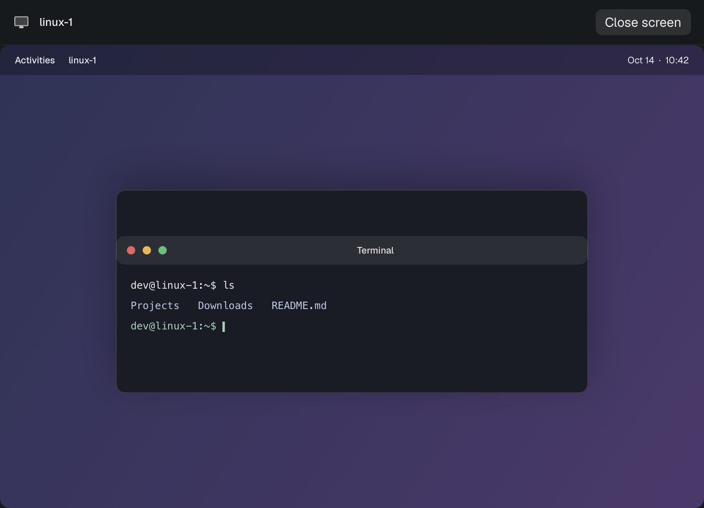
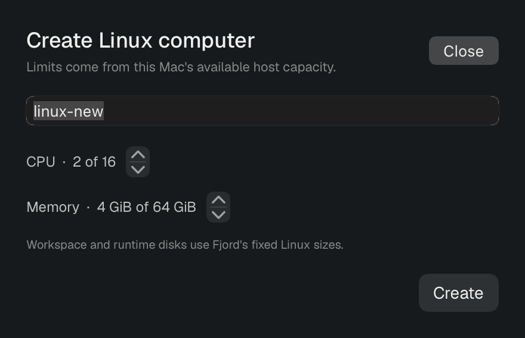
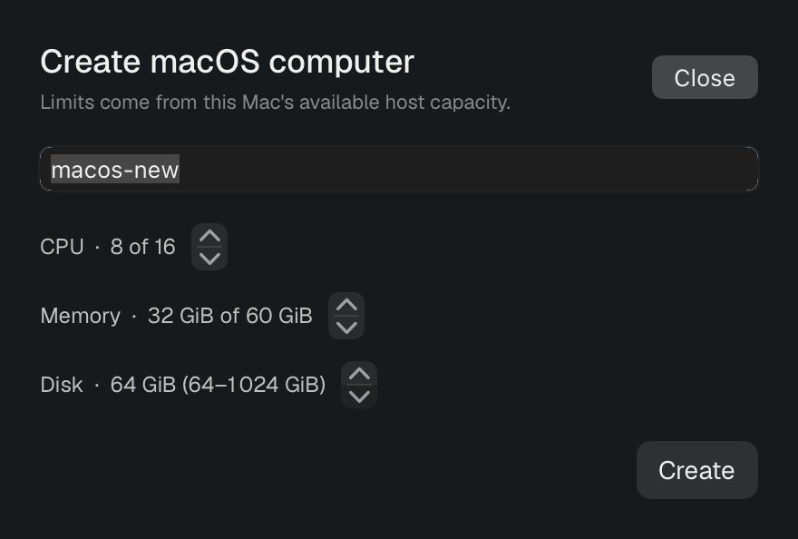
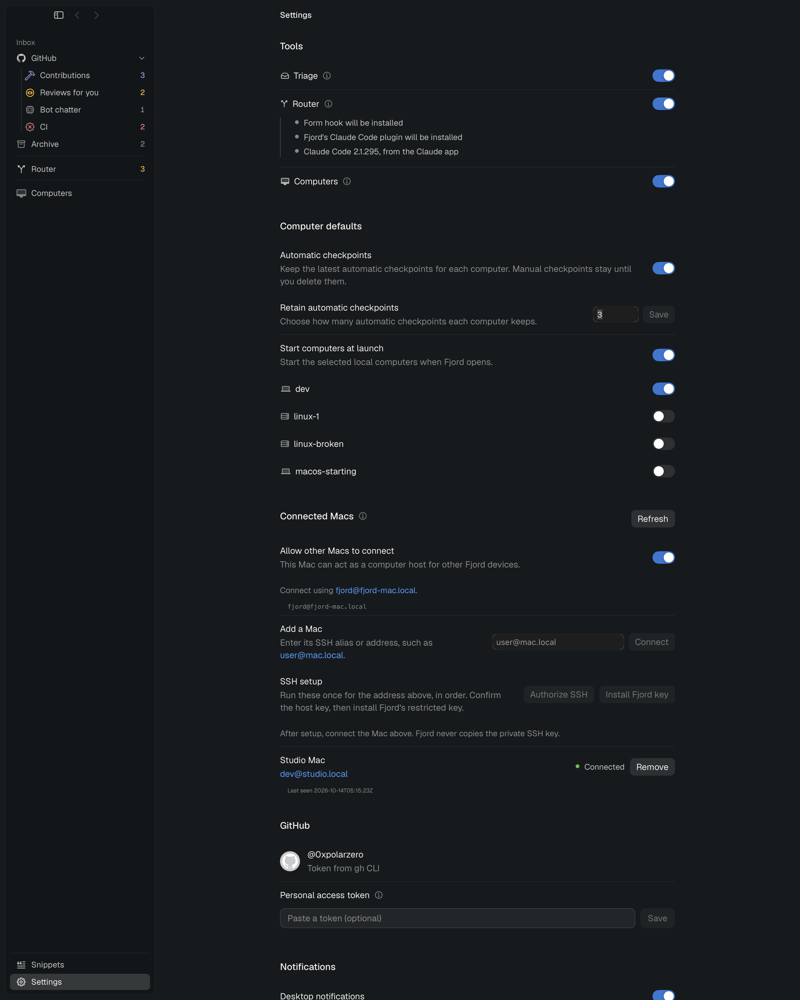

# P4 Computers implementation

Implemented the Computers tool in Fjord against the generated Silo client contract and a stateful `MockEngineClient`. The work covers the Computers detail sections, host creation and resource editing, checkpoints, files, network and SSH, per-computer GitHub policy, secrets, computer-use approval, logs and activity, storage, export/import, connected Macs, Linux screen viewing, and Computers settings.

## Delivery

- Linux and macOS creation reads host facts and enforces host-derived CPU, memory, and disk limits. Resource edits validate the same limits and stop running computers before applying changes.
- Checkpoints show measured usage and support create, restore, fork, delete, and pending-restore abandonment. Settings use retention count `0` for the explicit Off switch and flush before either quit choice disconnects.
- File browsing pages by snapshot, uploads and downloads use native file panels, and operations wait for their job outcomes. Logs support source, text, time range, record context, paging, follow, sensitive-output and damaged-record indicators, plus filtered export.
- Network controls publish, open, and remove ports; Linux desktop port 6901 stays private behind Open screen. SSH access supports per-computer keys, bind address, port, and Terminal launch.
- Access controls include GitHub authorization and repository grants, push policy, write-only secrets with destination validation, and computer-use approval.
- Export state exposes recent archives, progress/results, result acknowledgement and confirmed dismissal. Import inspects the selected archive before choosing a source computer and starting the job.
- Connected Macs expose enablement, add/remove, SSH setup commands, health and last-seen status. Removal uses the engine's owner-side key revocation operation and keeps the saved device when revocation fails.
- macOS Open screen calls `display.show`; Linux opens a private WebKit viewer with a scoped cookie and same-origin localhost navigation.

## Screenshots

Rendered with `FJORD_THEME=dark .build/debug/Fjord --window-shots` and visually checked after the final UI adjustments.

| Surface | Shot |
| --- | --- |
| Computer overview and checkpoints |  |
| File browser |  |
| Network and SSH |  |
| GitHub and secrets |  |
| Activity and logs |  |
| Storage and export result |  |
| Linux viewer |  |
| Linux creation |  |
| macOS creation |  |
| Computers settings and connected Macs |  |

## Verification

- `swift build`: passed after the shared Triage/run source settled.
- `scripts/test.sh`: the first attempt stopped during test-target compilation on nested `#require` macro errors in the concurrent Triage-owned `Tests/FjordTests/ComputerRunTests.swift`; that owner fixed them. The first full run then exposed an incorrect resource-summary expectation in `ComputersTests`; the test now includes the unchanged disk size. The final serialized run passed all 1,687 tests in 163 suites. The pre-existing `test.log` was restored after each invocation.
- `git diff --check` and Swift parser checks on the Computers-owned sources passed before the final test run.

## Limits

- The feature was exercised through `MockEngineClient`; this work did not connect to a live Silo service.
- The generated API does not define the macOS CPU/memory configuration payload (10 §3, Q13). The mock accepts a tagged `macosResources` change on the canonical `computers.configuration.change` method. The live owner must confirm that payload before using macOS resource edits with a real Silo engine.
