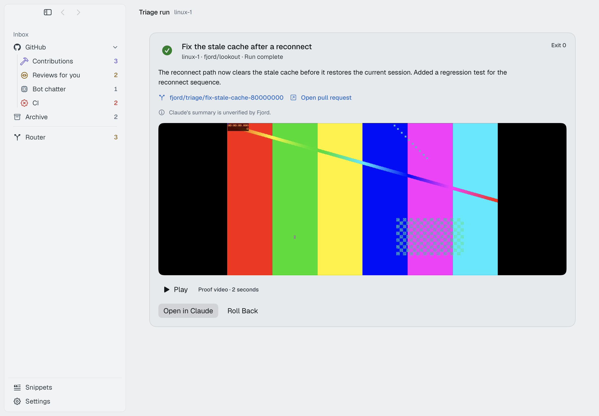
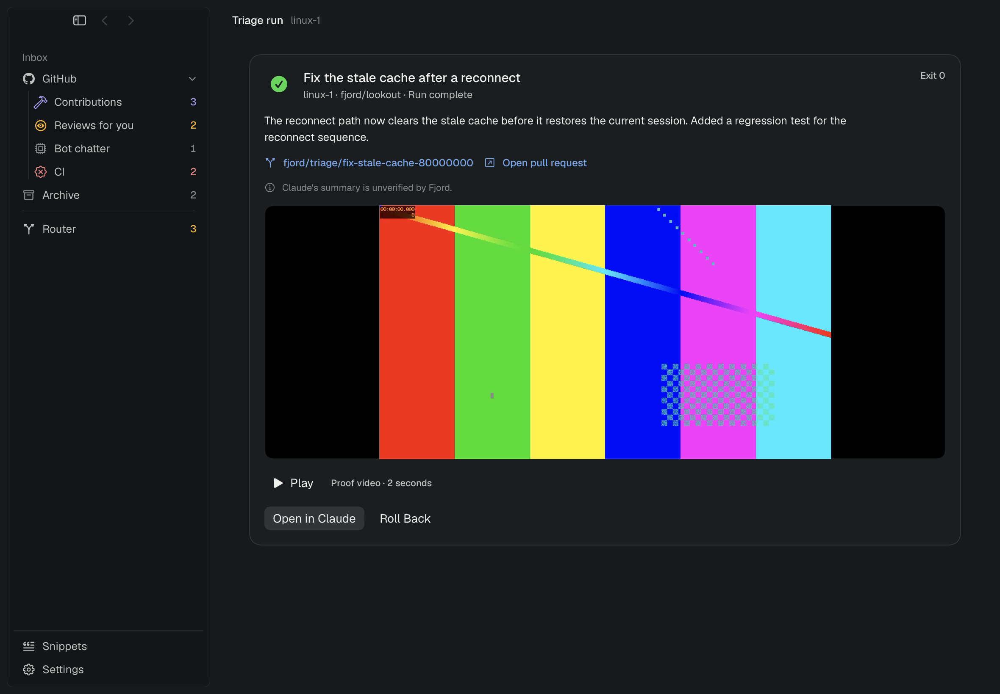

# P4 Triage: Run in a computer

Scope: [P4 design §3](../design/p4.md#3-triage-run-in-a-computer), [Fjord needs §3](../70-fjord-needs.md#3-triage-unattended-runs), and decisions A-9/A-18 in [95-decisions.md](../95-decisions.md).

## Status

The Triage action, persisted run coordinator, guest supervisor, proof retrieval, and result card are implemented against the EngineClient and GuestClient mocks. Production execution remains closed behind B-17: the probe inherited the secret placeholder and reached HTTPS, but did not prove OAuth Bearer substitution or a successful authenticated Claude request. The coordinator's qualified authorization exists for mock coverage only; the production performer always uses the closed gate.

## Implementation

- Added the **Run in a computer** rule action with an explicit owner/computer placement, guest workspace root, prompt template, Claude model and effort, permission mode, allowed tools, and proof toggle. The editor previews the target, clone path, checkpoint label, prompt, and proof setting. It warns about B-17 and the token setup flow.
- Added a durable Triage run record linked from `ActionRun`. Runs preflight the automatic-checkpoint retention, assigned `CLAUDE_CODE_OAUTH_TOKEN` secret, GitHub repository grant, computer inventory, guest account, and Linux desktop readiness. The rule and trigger are checked again before checkpoint and guest task admission.
- Clones or fetches the repository through `guest.exec`, creates an automatic checkpoint named `Before run: <task>, deleted automatically`, waits for the checkpoint job result, then prepares a private guest supervisor and starts headless `claude -p` with stream-JSON output through `guest.exec.start`.
- The guest supervisor requires the Silo token placeholder, removes competing provider credentials, rejects Claude settings that select a competing auth helper or gateway, and owns the proof recorder and Claude child. Linux uses ffmpeg x11grab with the Silo display and Xauthority. macOS uses the bundled ScreenCaptureKit app as an Aqua LaunchAgent. Fjord validates the guest manifest and retrieves the video in bounded `guest.files.read` ranges before attaching the local artifact to the result.
- The result card shows task summary and exit outcome, a same-repository branch link, a same-repository PR link when Claude reports one, proof video or its failure state, **Open in Claude**, and **Roll Back**. Claude's summary remains marked unverified. Rollback is disabled until task outcome is confirmed.
- Added deterministic light and dark result-card window shots. Their demo clip is generated locally for the screenshots; it is not evidence of a guest run. The playback controls sit below the movie so the AppKit video surface cannot cover their labels.

| Appearance | Result card |
| --- | --- |
| Light |  |
| Dark |  |

## Verification

- `scripts/build-guest-recorder.sh` succeeded on this arm64 Mac and produced `build/GuestRuns/GuestRecorder.app.zip`.
- `node --check Resources/GuestRuns/run.mjs`, `bash -n scripts/build-guest-recorder.sh scripts/build-app.sh`, `git diff --check`, and Swift parser checks passed.
- The final `swift build` passed. It emitted existing Swift concurrency warnings in `AppWindow.swift`, `AppTransition.swift`, `Claude.swift`, `GlassCapture.swift`, `MotionGate.swift`, and `SettingsView.swift`, plus the package's existing unhandled-fixture warning.
- The final serialized `scripts/test.sh` run compiled and ran 1,687 tests in 163 suites. All 14 `ComputerRunTests` passed. The full run ended with two issues: `ComputersTests.resourceEditAppliesCpuAndMemoryToStoppedMacComputer` expected the old CPU/memory-only label while the Computers model now includes disk, and `GuestRouterTests.guestTurnCompletionAndIdentitySurviveLocalMirrorRefresh` observed a missing session (`nil` instead of `running == false`). The latter passed when rerun alone with `swift test --filter GuestRouterTests/guestTurnCompletionAndIdentitySurviveLocalMirrorRefresh`. The earlier compile-only attempt was caused by nested `#require` macros in `ComputerRunTests.swift`; those reads are now split into explicit extraction and decode steps.
- The XCTest additions cover action serialization and destination routing, placement validation, prompt fencing and PR scoping, production gate refusal, checkpoint-off and missing-secret preflights, starting a stopped computer before guest work, rule invalidation before exec, Linux desktop readiness, reattachment without duplicate exec, rollback gating, proof failure isolation, and the full mock checkpoint → clone → guest job → video retrieval → rollback path.

## Evidence and limits

- Linux B-17 is **PARTLY** verified: the guest inherited the placeholder and CA, and `claude -p` reached an HTTPS endpoint, but the response was unauthorized and no proxy evidence proved Bearer substitution. The Linux B-24 probe confirmed ffmpeg capture of a JPEG from display `:1.0` with `/run/silo-desktop/user/Xauthority`; it did not qualify movie finalization.
- The macOS B-24 follow-up confirmed a 10.23-second ScreenCaptureKit movie from an Aqua LaunchAgent with a Silo-style Screen Recording TCC grant and approval ledger. This implementation packages a helper but does not install that TCC grant or approval ledger. The local `Fjord Dev` signature has no Team ID and does not establish the stable production code requirement used by the probe. Therefore macOS proof is not yet a qualified production path.
- Generated checkpoint and `guest.exec.start` methods expose no transport `operationId` parameter. The persisted UUIDs are workflow identifiers only. If admission becomes uncertain, Fjord keeps the run unconfirmed and refuses to resubmit; this prevents a duplicate but cannot provide server-side deduplication.
- A restart after `execJobID` is saved reattaches with `guest.exec.get` and never starts another task. A restart earlier in preparation has no saved job ID to resume and becomes unconfirmed. The current GuestClient also hides the server's first retained sequence, so Fjord detects sequence regression but cannot identify every truncated-output gap.
- Video retrieval caps the local copy at 64 MiB and checks stable size, inode, mtime, and manifest byte count. The supervisor has no recording duration/byte cap; the transfer does not verify a cryptographic hash or resume offsets, and guest proof cleanup/retry is not implemented.
- No live guest Triage run was attempted. That is a deliberate consequence of the explicit B-17 production gate, not a passing authentication result.

Claude Code's current primary authentication documentation places several provider credentials and `apiKeyHelper` ahead of `CLAUDE_CODE_OAUTH_TOKEN`, and documents gateway sign-in outside that precedence list. The supervisor clears provider environment variables and rejects competing settings, but this does not prove the Silo proxy substitution path. See [Claude Code authentication](https://code.claude.com/docs/en/authentication) and [Claude Code environment variables](https://code.claude.com/docs/en/env-vars).

## Next action

Qualify B-17 with a controlled Bearer substitution check and harmless authenticated `claude -p` request, then add the guest TCC provisioning seam and bounded, hash-verified proof transfer before opening the production gate.
